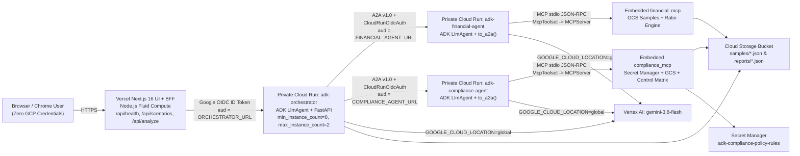

# Enterprise Multi-Agent Risk & Compliance System (ADK + A2A + MCP on Cloud Run)

An enterprise-grade multi-agent financial analysis and SOX/SOC2 compliance auditing system built with **Google ADK (`2.15.0`)**, **Agent-to-Agent (`A2A v1.0`)**, **Model Context Protocol (`MCP 2.3.0` stdio `MCPServer`)**, **Vertex AI (`gemini-3.8-flash` on `global`)**, **Private GCP Cloud Run (`$0` idle cost)**, and a **Next.js 16 App Router UI + Server-Side OIDC BFF** on **Vercel Fluid Compute**.

## Live Deployment

- **Interactive Web Console (Vercel Production)**: [https://enterprise-adk-a2a-mcp.vercel.app](https://enterprise-adk-a2a-mcp.vercel.app)
- **Private Cloud Run Services (`us-central1`, IAM-enforced — direct unauthenticated calls return `401/403`)**:
  - `adk-orchestrator` (`min_instance_count = 0`, `max_instance_count = 2`, invoked exclusively by `vercel-bff-invoker` SA via server-side OIDC)
  - `adk-financial-agent` (`min_instance_count = 0`, `max_instance_count = 2`, invoked exclusively by `adk-orchestrator` SA via A2A + OIDC)
  - `adk-compliance-agent` (`min_instance_count = 0`, `max_instance_count = 2`, invoked exclusively by `adk-orchestrator` SA via A2A + OIDC)

---

## System Architecture



---

## Key Architectural Guarantees

### 1. Zero Idle Cost Policy & Resource Sizing

| Component | Platform / Region | Scaling / Tier | Idle Cost |
|---|---|---|---|
| `adk-orchestrator` | Cloud Run v2 (`us-central1`) | `min_instance_count = 0`, `max_instance_count = 2`, `deletion_protection = false` | **$0 / month** |
| `adk-financial-agent` | Cloud Run v2 (`us-central1`) | `min_instance_count = 0`, `max_instance_count = 2`, `deletion_protection = false` | **$0 / month** |
| `adk-compliance-agent` | Cloud Run v2 (`us-central1`) | `min_instance_count = 0`, `max_instance_count = 2`, `deletion_protection = false` | **$0 / month** |
| Vertex AI Gemini | `gemini-3.8-flash` (`global`) | Pay-per-token (`GOOGLE_GENAI_USE_VERTEXAI=TRUE`) | **$0 / month** |
| Cloud Storage | `enterprise-adk-docs-gen-lang-client-0527325883` | Standard pay-per-GB / request | **~$0 / month** |
| Secret Manager | `adk-compliance-policy-rules` | Pay-per-secret-version / access | **~$0 / month** |
| Next.js BFF & UI (`web/`) | Vercel Fluid Compute (Node.js) | Active CPU pricing (`maxDuration = 120`, zero `edge`) | **$0 / month** |

### 2. Private Cloud Run IAM & Zero-Trust Matrix

No `allUsers` or `allAuthenticatedUsers` IAM bindings exist on any Cloud Run service. Direct unauthenticated HTTP calls return `401 Unauthorized` / `403 Forbidden`.

| Service Account | Scoped IAM Roles | Target Resource |
|---|---|---|
| `vercel-bff-invoker` | `roles/run.invoker` | `adk-orchestrator` **only** |
| `adk-orchestrator` | `roles/run.invoker`, `roles/aiplatform.user`, `roles/storage.objectUser` | `adk-financial-agent`, `adk-compliance-agent`, Vertex AI, GCS reports |
| `adk-financial-agent` | `roles/aiplatform.user`, `roles/storage.objectViewer` | Vertex AI, GCS sample docs |
| `adk-compliance-agent` | `roles/aiplatform.user`, `roles/storage.objectViewer`, `roles/secretmanager.secretAccessor` | Vertex AI, GCS sample docs, `adk-compliance-policy-rules` |

### 3. Technology Stack

- **Backend Agents & Orchestrator (Python 3.12 via `uv`)**:
  - `google-adk[a2a,mcp]==2.15.0`, `a2a-sdk==1.3.1`, `mcp==2.3.0` (`from mcp.server.mcpserver import MCPServer`), `google-genai==2.34.0`
  - `fastapi==0.165.0`, `httpx==0.28.1`, `google-cloud-storage==3.17.1`, `google-cloud-secret-manager==2.32.0`
  - Vertex AI Gemini GA model: `gemini-3.8-flash` with `GOOGLE_CLOUD_LOCATION=global`
- **Frontend & OIDC BFF (`web/`, `pnpm` exclusively)**:
  - `next@^16.4.6` (App Router, Node.js Fluid Compute), `react@^19.3.1`, `tailwindcss@^4.3.5`
  - `google-auth-library@^11.3.4` (`GoogleAuth` + `getIdTokenClient(CLOUD_RUN_ORCHESTRATOR_URL)`), `zod@^4.6.7`, `server-only`, `@playwright/test@1.64.1`

---

## Synthetic Enterprise Scenarios

| Scenario ID | Company | Highlighted Risk & Controls |
|---|---|---|
| `q3_cloud_vendor_review` | Meridian Retail Analytics Corp. | **HIGH RISK**: `+28.00%` ($896k) cloud budget variance without waiver (`FIN-VAR-01`) + missing Finance dual-approval on $660k GPU amendment (`SOX-APPR-02`) |
| `series_b_revenue_audit` | Northwind Cloud Robotics Inc. | **LOW RISK**: Clean baseline (`+1.43%` variance, ASC 606 five-step verified, full dual approvals, valid vendor SOC2 reports, intact SoD) |
| `treasury_controls_memo` | Helios FinTech Payments Inc. | **CRITICAL RISK**: Segregation of Duties self-approval breach on $840k wire (`TRES-SOD-04`), unvetted/expired vendor SOC2 (`SOC2-VEND-03`), `+22.00%` variance, $185k aged suspense |

---

## Reproducible Setup & Deployment

> **Toolchain Policy**: This project uses **`pnpm` exclusively** for all Node.js/Next.js tasks (never `npm`, `npx`, or `package-lock.json`) and **`uv`** for Python 3.12 services.

### 1. Local Web UI & BFF Development (`web/`)

```bash
cd web
cp .env.example .env.local
# For local orchestrator dev only (strictly ignored when NODE_ENV=production or on Vercel):
# LOCAL_DEV_ORCHESTRATOR_URL=http://127.0.0.1:8080

pnpm install
pnpm test              # Unit tests for OIDC config, PEM normalization, and error redaction
pnpm run typecheck     # next typegen && tsc --noEmit
pnpm run lint          # eslint .
pnpm run build         # Production Next.js build
pnpm exec playwright test
```

### 2. Provision GCP Infrastructure & Cloud Run Services

Container images are built in GCP Cloud Build and deployed via Terraform (`min_instance_count=0`, `max_instance_count=2`, private IAM):

```powershell
# Authenticate gcloud & Terraform, then build + apply:
./scripts/deploy-gcp.ps1
```

### 3. Deploy Web UI + OIDC BFF to Vercel (Isolated `web/` Scope)

Always execute Vercel commands inside `web/` so `web/.vercel/` stays isolated:

```bash
cd web
pnpm add -g vercel
vercel link
# Set server-only Secret env vars (NEVER prefix with NEXT_PUBLIC_):
# CLOUD_RUN_ORCHESTRATOR_URL, GCP_CLIENT_EMAIL, GCP_PRIVATE_KEY
vercel --prod
```

---

## Documentation Index

- **[docs/ARCHITECTURE.md](docs/ARCHITECTURE.md)** — Sequence diagrams, protocol deep-dive, ADRs, and security threat model.
- **[docs/DEMO_WALKTHROUGH.md](docs/DEMO_WALKTHROUGH.md)** — Pre-flight IAM/health checks, 1-click scenario walkthroughs, and troubleshooting.
- **[docs/VIDEO_SCRIPT.md](docs/VIDEO_SCRIPT.md)** — 3-minute timestamped presentation script with visual cues and spoken narration.
