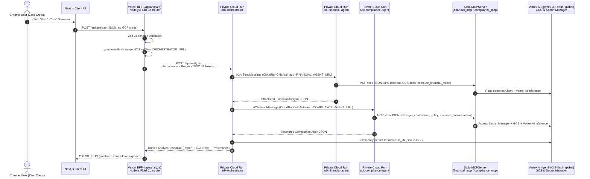

# Architecture Deep-Dive & ADRs

## 1. End-to-End Request & OIDC Sequence

---

## 2. Architecture Decision Records (ADRs)

### ADR-001: Embedded Stdio `MCPServer` vs. Standalone HTTP MCP Services
- **Decision**: Embed each domain's `MCPServer` (`mcp==2.3.0`, `from mcp.server.mcpserver import MCPServer`) inside its specialized Cloud Run container (`adk-financial-agent` and `adk-compliance-agent`) and connect via ADK `McpToolset(StdioConnectionParams(..., timeout=30))`.
- **Rationale**:
  1. Eliminates extra network hops, extra Cloud Run services, and extra OIDC token exchanges between an agent and its deterministic local tools.
  2. Preserves strict least-privilege IAM boundaries at the container level (`adk-financial-agent` cannot read `adk-compliance-policy-rules` in Secret Manager; `adk-compliance-agent` owns that binding).
  3. Keeps cold-start overhead bounded to 3 Cloud Run services (`min_instance_count = 0`, `max_instance_count = 2`).
- **Trade-offs**: MCP tool servers scale 1:1 with their owning agent container rather than independently, which is ideal for lightweight stateless GCS/Secret Manager/matrix operations.

### ADR-002: `gemini-3.8-flash` on `GOOGLE_CLOUD_LOCATION=global`
- **Decision**: Configure all ADK `LlmAgent` instances with `GEMINI_MODEL=gemini-3.8-flash`, `GOOGLE_GENAI_USE_VERTEXAI=TRUE`, and `GOOGLE_CLOUD_LOCATION=global` while deploying Cloud Run services in `us-central1`.
- **Rationale**:
  1. `gemini-2.0-flash` and `gemini-2.5-*` models are retired; `gemini-3.8-flash` is the active GA Vertex AI model.
  2. Vertex AI routes `gemini-3.8-flash` via the `global` endpoint for higher availability and quota resilience, decoupled from regional Cloud Run compute in `us-central1`.

### ADR-003: Vercel Node.js Fluid Compute BFF vs. Edge Runtime or Browser Direct Calls
- **Decision**: Execute `/api/health`, `/api/scenarios`, and `/api/analyze` on Vercel's default Node.js Fluid Compute runtime (`export const dynamic = 'force-dynamic'; export const maxDuration = 120;`, omitting `export const runtime`).
- **Rationale**:
  1. `google-auth-library` relies on Node.js `crypto` and `https` to sign RS256 service account assertions and exchange them for Google OIDC ID tokens — incompatible with Edge runtime (`runtime = 'edge'`, which is also unsupported in Next.js 16.3+).
  2. Cold-starting 3 scale-to-zero Cloud Run containers + A2A + Vertex AI reasoning can take 20–60s, which exceeds Edge's 25s first-byte timeout; `maxDuration = 120` on Fluid Compute handles cold multi-agent execution cleanly.
  3. Keeping `CLOUD_RUN_ORCHESTRATOR_URL`, `GCP_CLIENT_EMAIL`, and `GCP_PRIVATE_KEY` strictly server-side guarantees zero credential leakage to the browser.

### ADR-004: Zero-Idle-Cost Private Cloud Run (`min_instance_count = 0`, `max_instance_count = 2`)
- **Decision**: Enforce `min_instance_count = 0`, `max_instance_count = 2`, and `deletion_protection = false` in Terraform across all 3 Cloud Run v2 services, with `roles/run.invoker` granted exclusively per service account.
- **Rationale**: Guarantees `$0` idle compute cost for portfolio/demo deployments while bounding burst concurrency and preventing public invocation (`401`/`403` fail-closed).

---

## 3. Security Controls & Hardening Checklist

| Threat Vector | Control Implemented | Location |
|---|---|---|
| Browser secret exposure | Zero `NEXT_PUBLIC_*` GCP vars; `import 'server-only'` in `gcp-bff.ts` | `web/src/lib/gcp-bff.ts` |
| Unauthenticated Cloud Run access | Private IAM (`roles/run.invoker` only to SA); no `allUsers` | `infra/terraform/iam.tf` |
| OIDC `aud` mismatch (`401`) | Trailing slash & path validation (`normalizeBaseUrl`) | `web/src/lib/bff-config.ts` |
| Escaped `\n` PEM corruption | `normalizePrivateKey` unescapes `\\n` -> `\n` & strips quotes | `web/src/lib/bff-config.ts` |
| Prod bypass via local dev env | `LOCAL_DEV_ORCHESTRATOR_URL` blocked when `NODE_ENV === 'production'` or `VERCEL` is set, and restricted to localhost | `web/src/lib/bff-config.ts` |
| Bearer/PEM leakage in logs/HTTP | `sanitizeErrorText` strips JWTs, `Bearer` tokens, and full PEM blocks | `web/src/lib/bff-config.ts` |
| Oversized payloads (`413`) | Zod v4 schema bounds (`prompt <= 4000`, `document_text <= 200,000`) | `web/src/lib/schemas.ts` |
